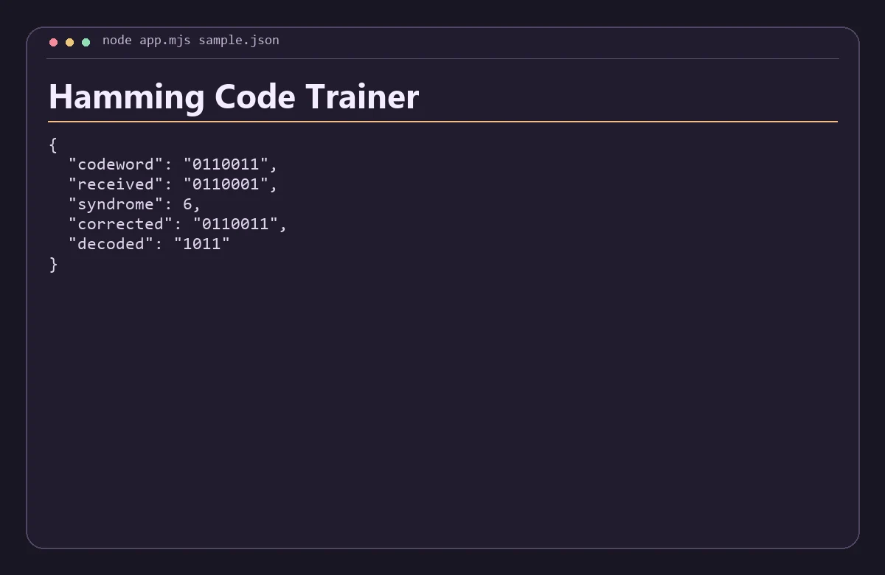

# Hamming Code Trainer

Generate an even-parity Hamming (7,4) codeword, introduce a single-bit error, and inspect the correction syndrome.



## Run

Install Node.js 22 or newer. Run these commands from the repository root.

```sh
node app.mjs sample.json
```

Replace `sample.json` with a JSON file following the same structure. The app prints a JSON report to standard output.

Use a four-character dataBits string with optional flip position 1 through 7, or a seven-character received string. The decoder assumes at most one bit is wrong.

## Verify

Run `python check.py` with Python 3.11 or newer after the build step when applicable. The check verifies the bundled scenario and confirms that an invalid input returns an error.
